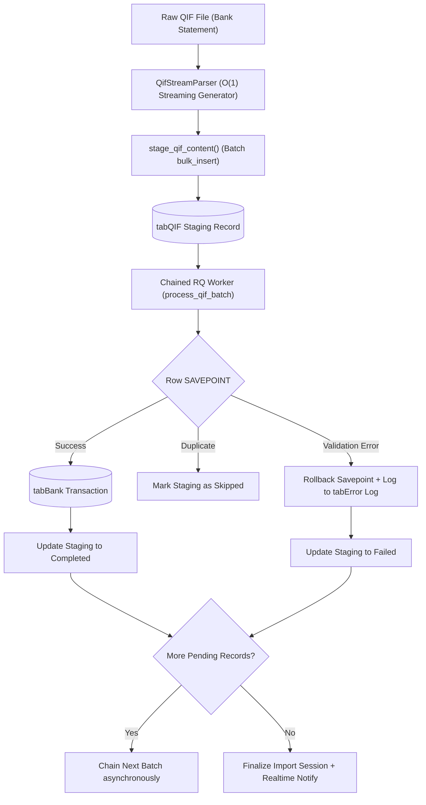

# Vyogo Frappe QIF

[](https://www.gnu.org/licenses/agpl-3.0)
[](https://frappeframework.com/)
[](https://erpnext.com/)
[](https://www.python.org/)

**Vyogo Frappe QIF** is a high-performance, streaming QIF (Quicken Interchange Format) statement importer for **Frappe Framework** and **ERPNext**. 

It provides an enterprise-grade financial ingestion pipeline featuring $O(1)$ memory streaming parsing, batch SQL staging, asynchronous chained background workers with row-level transaction savepoints, audit-safe ledger guards, and native multi-tenant SaaS compatibility.

---

## Key Features

- ⚡ **$O(1)$ Memory Streaming Parser**: Line-by-line generator parser capable of handling 50MB–100MB+ QIF statements without memory exhaustion.
- 📅 **Smart Date Sniffing & Disambiguation**: Automatically sniffs and parses UK/AU (`DD/MM/YYYY`) and US (`MM/DD/YYYY`) formats, handling 2-digit years, apostrophe separators (`'26`), and dotted formats.
- 🔢 **Occurrence Indexing & Deduplication**: Disambiguates multiple identical charges occurring on the same date (e.g. repeated transit or coffee charges) via deterministic occurrence hashing.
- 🗄️ **Batch Staging**: High-speed ingestion using MariaDB `frappe.db.bulk_insert` into dedicated `QIF Staging Record` doctype prior to ledger commitment.
- 🔄 **Chained Asynchronous Workers**: Non-blocking Redis Queue (RQ) workers processing 100 rows per batch, chaining subsequent batches asynchronously until complete.
- 🛡️ **Row-Level Transaction Isolation**: Every staged record is processed within an individual SQL `SAVEPOINT`. A single corrupted row fails cleanly into Frappe's standard `tabError Log` without rolling back the entire batch.
- 🛑 **Ledger Guard Undo**: Roll back an entire statement safely with a single API call or button click. If any transaction has already been reconciled by an accountant in ERPNext, the ledger guard blocks the deletion.
- 🌐 **Open Source & Multi-Tenant Compatible**: Runs 100% cleanly on vanilla single-tenant open source Frappe / ERPNext sites out-of-the-box. When deployed in multi-tenant SaaS environments (e.g. `saas_platform`), it automatically activates tenant isolation, session context restoration, and MariaDB persistence guards.
- 📡 **Real-time Progress Reporting**: Emits live Socket.io events (`qif_import_progress`) for dynamic web UI progress bars and status updates.

---

## Architecture & Data Flow



---

## Installation

### Using Frappe Bench

```bash
cd /path/to/frappe-bench

# Get the app
bench get-app https://github.com/vyogotech/vyogo_frappe_qif.git --branch main

# Install on your site
bench --site your-site.local install-app vyogo_frappe_qif

# Run migrations
bench --site your-site.local migrate
```

### Using frappectl

```bash
frappectl app get https://github.com/vyogotech/vyogo_frappe_qif.git
frappectl app install vyogo_frappe_qif --site your-site.local
```

---

## Usage

### 1. Ingest & Stage QIF Statements

Stage statements via Frappe Python API or REST:

```python
import frappe
from vyogo_frappe_qif.importer.staging import stage_qif_content

with open("statement.qif", "r") as f:
    qif_text = f.read()

result = stage_qif_content(
    import_session="BSI-2026-00001",
    content=qif_text,
    company="My Company Pty Ltd",
    date_format="%d/%m/%Y",  # Optional: sniffer auto-detects if omitted
)
print(result)
# {'import_session': 'BSI-2026-00001', 'total_staged': 1420, 'tenant_id': None}
```

### 2. Start Asynchronous Import

```python
from vyogo_frappe_qif.importer.worker import process_qif_batch

# Queue worker in Redis Queue (RQ)
frappe.enqueue(
    method="vyogo_frappe_qif.importer.worker.process_qif_batch",
    queue="default",
    import_session="BSI-2026-00001",
    user=frappe.session.user,
    batch_size=100,
)
```

### 3. Safe Undo with Ledger Guard

```python
from vyogo_frappe_qif.importer.worker import undo_qif_import

try:
    res = undo_qif_import("BSI-2026-00001")
    print(res)
except frappe.ValidationError as e:
    # Triggered if any transaction has already been Reconciled in ERPNext
    print("Rollback blocked by Ledger Guard:", e)
```

---

## REST / Frappe RPC Endpoints

All endpoints are whitelisted and accessible via standard Frappe REST API (`/api/method/...`):

| Endpoint | Method | Parameters | Description |
| :--- | :--- | :--- | :--- |
| `vyogo_frappe_qif.api.upload_and_stage_qif` | `POST` | `import_session`, `file_url`, `company`, `date_format` | Reads QIF file and stages records into database. |
| `vyogo_frappe_qif.api.start_qif_import` | `POST` | `import_session`, `batch_size` (default: 100) | Enqueues chained background worker. |
| `vyogo_frappe_qif.api.undo_import` | `POST` | `import_session` | Safely deletes unreconciled transactions and resets staging. |
| `vyogo_frappe_qif.api.retry_failed` | `POST` | `import_session` | Resets failed staging rows to Pending and re-enqueues worker. |

---

## Multi-Tenant SaaS Compatibility

`vyogo_frappe_qif` is architected for dual-mode deployment:
- **Vanilla Open-Source ERPNext**: Runs with standard single-tenant ERPNext models with zero overhead or external dependencies.
- **Multi-Tenant Cloud Platforms (e.g. Vyogo SaaS Platform / `saas_platform`)**:
  - Dynamically activates via `tenant_compat.py`.
  - Automatically monkey-patches `BaseDocument.get_valid_dict()` so raw DDL `tenant_id` columns persist during `Bank Transaction.insert()`.
  - Restores user and tenant session state in background worker queues so jobs do not revert to `SYSTEM`.
  - Scopes idempotency filters by `tenant_id` to prevent cross-tenant collisions.
  - Verifies MariaDB column persistence with post-insert database guarantees.

---

## Running Automated Tests

Run the full test suite in your Frappe bench environment:

```bash
bench --site your-site.local run-tests --app vyogo_frappe_qif
```

Test suite coverage includes:
- `test_qif_stream_parser`: Date sniffing, line parsing, and occurrence disambiguation.
- `test_staging_multitenancy`: High-speed batch staging and tenant separation.
- `test_batch_processing_and_idempotency`: Chunked processing and duplicate suppression.
- `test_bank_transaction_tenant_persistence`: SQL column persistence across document models.
- `test_ledger_guard_blocks_undo_for_reconciled`: Protection against rolling back reconciled transactions.
- `test_row_failure_logs_to_error_log`: Verification that row-level exceptions write to Frappe's `Error Log`.

---

## Contributing

1. Fork the repository on GitHub.
2. Create your feature branch (`git checkout -b feature/amazing-feature`).
3. Commit your changes (`git commit -m 'feat: add amazing feature'`).
4. Push to the branch (`git push origin feature/amazing-feature`).
5. Open a Pull Request.

---

## License

This software is licensed under the **GNU Affero General Public License v3.0 (AGPL-3.0)**.  
See the [LICENSE](LICENSE) file for details.

Developed with ❤️ by **[Vyogo Technologies](https://vyogo.tech)** (`dev@vyogo.tech`).
