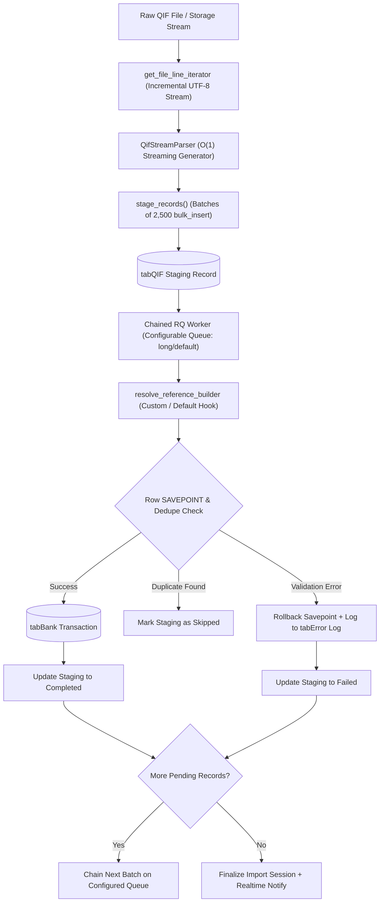

# Vyogo Frappe QIF

[](https://www.gnu.org/licenses/agpl-3.0)
[](https://frappeframework.com/)
[](https://erpnext.com/)
[](https://www.python.org/)

**Vyogo Frappe QIF** is a high-performance, truly streaming QIF (Quicken Interchange Format) statement importer for **Frappe Framework** and **ERPNext**. 

It provides an enterprise-grade financial ingestion pipeline featuring true $O(1)$ memory streaming line decoding, format-agnostic batch SQL staging, pluggable reference scheme generation, configurable background queues, row-level transaction savepoints, audit-safe ledger guards, and native multi-tenant SaaS compatibility.

---

## Key Features

- ⚡ **True $O(1)$ Memory Streaming Pipeline**: Streams statements directly from disk or remote storage line-by-line via incremental decoding (`utf-8-sig`, universal newlines handling CRLF, LF, CR, and BOM). Files are never materialized into memory twice.
- 🔌 **Pluggable Storage Hook (`qif_file_line_reader`)**: Stream statements directly from remote object stores (S3, GCS, Azure Blob) without downloading the entire file to the web application server.
- 🧩 **Pluggable Reference Scheme (`qif_reference_builder`)**: Inject host-specific reference number algorithms and idempotency keys to match existing transaction numbering schemes.
- 🚦 **Configurable Queue Routing**: Execute statement imports on dedicated queues (`long`, `default`, or custom) configured via site config (`qif_import_queue`), hooks, or runtime arguments.
- 📦 **Format-Agnostic Staging Engine**: Modular `stage_records()` pipeline consumes any iterable of normalized transaction dictionaries (QIF, OFX, CSV, CAMT.053).
- 📅 **Smart Date Sniffing & Disambiguation**: Automatically sniffs and parses UK/AU (`DD/MM/YYYY`) and US (`MM/DD/YYYY`) formats, handling 2-digit years, apostrophe separators (`'26`), and dotted formats.
- 🔢 **Occurrence Indexing & Deduplication**: Disambiguates multiple identical charges occurring on the same date via deterministic occurrence hashing.
- 🗄️ **Batch Staging**: High-speed ingestion using MariaDB `frappe.db.bulk_insert` into dedicated `QIF Staging Record` doctype prior to ledger commitment.
- 🔄 **Chained Asynchronous Workers**: Non-blocking Redis Queue (RQ) workers processing 100 rows per batch, chaining subsequent batches asynchronously until complete.
- 🛡️ **Row-Level Transaction Isolation**: Every staged record is processed within an individual SQL `SAVEPOINT`. A single corrupted row fails cleanly into Frappe's standard `tabError Log` without rolling back the entire batch.
- 🛑 **Ledger Guard Undo**: Roll back an entire statement safely with a single API call or button click. If any transaction has already been reconciled by an accountant in ERPNext, the ledger guard blocks the deletion.
- 🌐 **Open Source & Multi-Tenant Compatible**: Runs 100% cleanly on vanilla single-tenant open source Frappe / ERPNext sites out-of-the-box. When deployed in multi-tenant SaaS environments (e.g. `saas_platform`), it automatically activates tenant isolation, session context restoration, and MariaDB persistence guards.
- 📡 **Real-time Progress Reporting**: Emits live Socket.io events (`qif_import_progress`) for dynamic web UI progress bars and status updates.

---

## Architecture & Data Flow



---

## Normalized Record Schema

The format-agnostic staging pipeline (`stage_records`) consumes an `Iterable[dict[str, Any]]` conforming to the following schema:

| Field | Type | Description | Example |
| :--- | :--- | :--- | :--- |
| `date` | `str` | ISO formatted transaction date (`YYYY-MM-DD`) | `"2026-05-12"` |
| `amount` | `float` | Signed transaction amount (negative for withdrawal, positive for deposit) | `-55.00` |
| `payee` | `str` | Name of payee or counterpart (optional, max 140 chars) | `"OFFICE SUPPLIES PTY LTD"` |
| `memo` | `str` | Detailed transaction notes or memo (optional) | `"Tax invoice 1042"` |
| `reference_no` | `str` | Check number, cheque ID, or external reference (optional, max 140 chars) | `"1001"` |
| `occurrence_idx`| `int` | 1-based sequential occurrence count for same-day identical transactions | `1` |
| `dedupe_hash` | `str` | Deterministic SHA256 dedupe key (computed automatically if omitted) | `"3a7f82b1c904"` |

---

## Extension Hooks & Configuration

### 1. Storage Line Reader Hook (`qif_file_line_reader`)
Stream file contents directly from cloud storage (AWS S3, Google Cloud Storage, MinIO, Azure Blob) without buffering the file on local disk:

In your custom app's `hooks.py`:
```python
qif_file_line_reader = [
    "my_custom_app.storage.stream_s3_file_lines"
]
```

Signature:
```python
def stream_s3_file_lines(file_doc) -> Iterator[str]:
    # Stream lines directly from remote storage
    for line in s3_client.get_object(Bucket=..., Key=file_doc.file_url)["Body"].iter_lines():
        yield line.decode("utf-8")
```

### 2. Custom Reference Builder Hook (`qif_reference_builder`)
Customize how `Bank Transaction.reference_number` and deduplication idempotency keys are generated:

In your custom app's `hooks.py`:
```python
qif_reference_builder = [
    "my_custom_app.reference.custom_ref_builder"
]
```

Signature:
```python
def custom_ref_builder(row: dict, bank_account: str) -> str:
    """
    row contains: date, amount, payee, memo, reference_no, occurrence_idx, description, dedupe_hash
    """
    return f"REF-{bank_account[:6]}-{row['date']}-{row['occurrence_idx']}"
```

### 3. Configurable Queue Configuration
By default, long-running statement imports are queued on `"long"`. You can configure the queue via:

1. **Site Config (`site_config.json`)**:
   ```json
   {
     "qif_import_queue": "bank_statement_workers"
   }
   ```
2. **Frappe Hook (`hooks.py`)**:
   ```python
   qif_import_queue = ["bank_statement_workers"]
   ```
3. **API Call**:
   ```python
   frappe.call("vyogo_frappe_qif.api.import_qif", bank_statement_import="BSI-2026-00001", queue="short")
   ```

---

## How to Start the Import Job

You can start a QIF import in 4 simple ways:

### 1. In the ERPNext UI (No Code)
1. Go to **Accounting > Bank Statement Import** and click **Add Bank Statement Import**.
2. Select your **Company**, **Bank Account**, and attach your `.qif` file.
3. Save the document.
4. Click the blue **"Start QIF Import"** button in the top right.
   - The app stages all transactions with $O(1)$ memory usage, queues the background worker, and tracks real-time progress.
   - If you ever need to rollback, click **"Undo QIF Import"** (protected by Ledger Guard).

---

### 2. From Bench CLI (1 Line)
```bash
# Import an existing Bank Statement Import:
bench --site your-site.local execute vyogo_frappe_qif.api.import_qif --kwargs '{"bank_statement_import": "BSI-2026-00001"}'

# Or import a file directly from server disk with custom queue:
bench --site your-site.local execute vyogo_frappe_qif.api.import_qif --kwargs '{"file_path": "/path/to/statement.qif", "company": "My Company Pty Ltd", "bank_account": "Operating Account - Test Bank", "queue": "long"}'
```

---

### 3. Via REST API / cURL
```bash
curl -X POST https://your-site.local/api/method/vyogo_frappe_qif.api.import_qif \
  -H "Authorization: token <api_key>:<api_secret>" \
  -H "Content-Type: application/json" \
  -d '{
    "bank_statement_import": "BSI-2026-00001",
    "queue": "long"
  }'
```

---

### 4. In Python / Bench Console
```python
import frappe

# All-in-one execution (auto-stages and enqueues worker):
res = frappe.call("vyogo_frappe_qif.api.import_qif", bank_statement_import="BSI-2026-00001")
print(res)
# {"status": "queued", "import_session": "BSI-2026-00001", "total_staged": 1420, "queue": "long"}

# To run synchronously (for batch scripts / testing):
res = frappe.call("vyogo_frappe_qif.api.import_qif", bank_statement_import="BSI-2026-00001", async_run=False)
```

---

## Safe Undo with Ledger Guard
Roll back an entire statement safely:

```python
from vyogo_frappe_qif.importer.worker import undo_qif_import

try:
    res = undo_qif_import("BSI-2026-00001")
    print(res)
except frappe.ValidationError as e:
    # Triggered if any transaction has already been Reconciled in ERPNext
    print("Rollback blocked by Ledger Guard:", e)
```

---

## Multi-Tenant SaaS Compatibility

`vyogo_frappe_qif` is architected for dual-mode deployment:
- **Vanilla Open-Source ERPNext**: Runs with standard single-tenant ERPNext models with zero overhead or external dependencies.
- **Multi-Tenant Cloud Platforms (e.g. Vyogo SaaS Platform / `saas_platform`)**:
  - Dynamically activates via `tenant_compat.py`.
  - Automatically monkey-patches `BaseDocument.get_valid_dict()` so raw DDL `tenant_id` columns persist during `Bank Transaction.insert()`.
  - Restores user and tenant session state in background worker queues so jobs do not revert to `SYSTEM`.
  - Scopes idempotency filters by `tenant_id` to prevent cross-tenant collisions.
  - Verifies MariaDB column persistence with post-insert database guarantees.

---

## Running Automated Tests

Run the full bench test suite in your Frappe bench environment:

```bash
bench --site your-site.local run-tests --app vyogo_frappe_qif
```

Or run the fast pure unit test suite (including the 200,000-record $O(1)$ memory test) via pytest:

```bash
pytest tests
```

---

## License

This software is licensed under the **GNU Affero General Public License v3.0 (AGPL-3.0)**.  
See the [LICENSE](LICENSE) file for details.

Developed with ❤️ by **[Vyogo Technologies](https://vyogo.tech)** (`dev@vyogo.tech`).
